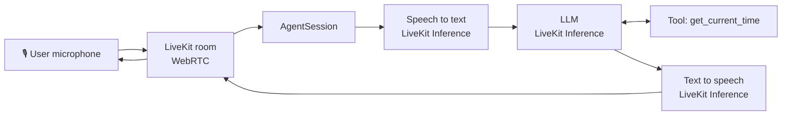

<div align="center">

# 🎙️ Voxa

### A real-time AI voice assistant built with LiveKit Agents

Speak naturally, ask a follow-up, interrupt mid-answer, or ask Voxa for the local time.

[](https://www.python.org/)
[](https://github.com/livekit/agents)
[](https://docs.livekit.io/agents/models/)

**[Quick start](#-quick-start) · [How it works](#-how-it-works) · [Setup](#-setup) · [Troubleshooting](#-troubleshooting)**

</div>

---

Voxa is a focused portfolio project demonstrating the building blocks of a natural voice conversation. It uses the official [LiveKit Agents](https://github.com/livekit/agents) framework to receive microphone audio, recognize speech, generate a response, and speak it back. The first version uses the LiveKit Agent Console instead of a custom frontend.

## ✨ What Voxa can do

| Capability | What it means |
| --- | --- |
| 🎧 Real-time voice | Talk through a microphone over LiveKit's WebRTC room. |
| 🧠 Multi-turn context | Ask follow-ups during a session; separate sessions have separate context. |
| 🔊 Spoken replies | LiveKit Inference connects the speech, language, and voice models. |
| ⚡ Natural turn-taking | SDK turn handling supports interruptions and false-interruption recovery. |
| 🕒 Current local time | A registered `get_current_time` tool reads the agent host's local clock and timezone. |
| 🔐 Credential-safe setup | API credentials come from `.env`, which is excluded from Git. |

> **Privacy note:** Voxa keeps no cross-session memory and does not save transcripts itself. LiveKit Cloud's inference and session policies still apply.

## 🚀 Quick start

### 1. Install the tools

You need macOS, Python 3.10+, [`uv`](https://docs.astral.sh/uv/getting-started/installation/), and a [LiveKit Cloud](https://cloud.livekit.io/) project. For the browser Agent Console, install the LiveKit CLI too (`brew install livekit-cli`).

### 2. Install Voxa and add credentials

```bash
git clone https://github.com/lohithl1024/Vexa-Voice-Agent.git
cd Vexa-Voice-Agent
uv sync
cp .env.example .env
```

Edit `.env` with the LiveKit project WebSocket URL, API key, and API secret. Find these in the project's settings/API keys in LiveKit Cloud. Keep `.env` private; never commit it.

### 3. Start the agent

```bash
uv run python agent.py dev
```

Open the LiveKit Cloud project, go to **Agents**, and launch the Agent Console for the running development agent. If you use the LiveKit CLI, `lk agent dev` can start the agent and provide a console link. Allow microphone access when prompted.

Prefer a local terminal session? Run:

```bash
uv run python agent.py console
```

For text-only terminal testing, add `--text`. Terminal console mode simulates the room locally, but still needs LiveKit credentials to call LiveKit Inference.

## 🗣️ Try a conversation

1. Say: “Hello Voxa, introduce yourself.”
2. Say: “I’m planning a weekend in Kyoto.” Then ask: “What did I say I was planning?”
3. Ask: “What time is it where you are?” Voxa should call `get_current_time`.
4. Interrupt a longer answer with a new question and continue the conversation.

The Agent Console can show the session transcript, tool calls, events, and audio activity. Actual model output, transcript quality, and interruptions depend on your LiveKit project, model availability, microphone, and network.

## 🧩 How it works



The conversation context lives in the active `AgentSession`. The agent's instructions keep answers friendly and concise, and direct date/time questions to the registered time tool. LiveKit Agents manages media, turn handling, and the model/tool handoff.

### Model configuration

The current defaults are Deepgram Flux for STT, Google Gemma 4 for the LLM, and Cartesia Sonic 3 for TTS, accessed through **LiveKit Inference**. Voxa therefore does not ask you to configure separate Deepgram, Google, or Cartesia API keys. Check your LiveKit project's current model catalog, access, and usage before running; availability and pricing can change.

## 🛠️ Setup details

### Required environment variables

| Variable | Purpose |
| --- | --- |
| `LIVEKIT_URL` | WebSocket URL for the LiveKit project (for example, `wss://your-project.livekit.cloud`). |
| `LIVEKIT_API_KEY` | Project API key used to authenticate the agent and inference requests. |
| `LIVEKIT_API_SECRET` | Secret paired with the project API key. Keep it private. |

The names and placeholders are in [.env.example](.env.example). No credentials are hard-coded in the source.

### Project structure

```text
voxa/
├── agent.py             # Agent, voice pipeline, and registered function tool
├── voxa/
│   ├── __init__.py
│   └── tools.py          # Local date/time helper
├── tests/
│   └── test_tools.py
├── .env.example
├── .gitignore
├── pyproject.toml
└── README.md
```

### Run the local check

```bash
uv run python -m unittest discover -s tests -v
```

This checks the time helper. It does not test a live microphone, model provider, LiveKit room, or Agent Console session.

## 🩺 Troubleshooting

<details>
<summary><strong>Missing credentials</strong></summary>

Confirm `.env` is beside `agent.py` and contains all three variables. Make sure the URL, key, and secret belong to the same LiveKit project.

</details>

<details>
<summary><strong>Inference or model unavailable</strong></summary>

Check that LiveKit Inference is available to your project and that the configured models are currently supported. Review the worker logs and your project's usage settings.

</details>

<details>
<summary><strong>Agent Console cannot see the agent</strong></summary>

Keep the development worker running, and open the console from the same LiveKit Cloud project. If using `lk`, authenticate with `lk cloud auth` and select the correct project.

</details>

<details>
<summary><strong>No microphone input or spoken output</strong></summary>

Allow microphone access in your browser or terminal, check macOS sound/privacy settings, and select the correct input and output devices. Inspect the Agent Console events and worker logs for service errors.

</details>

## 🗺️ Next steps

- Add configurable language and model selection.
- Add conversation-level tests with mocked model backends.
- Add optional noise cancellation and deployment configuration.
- Improve handling of unclear or incomplete speech.


---

